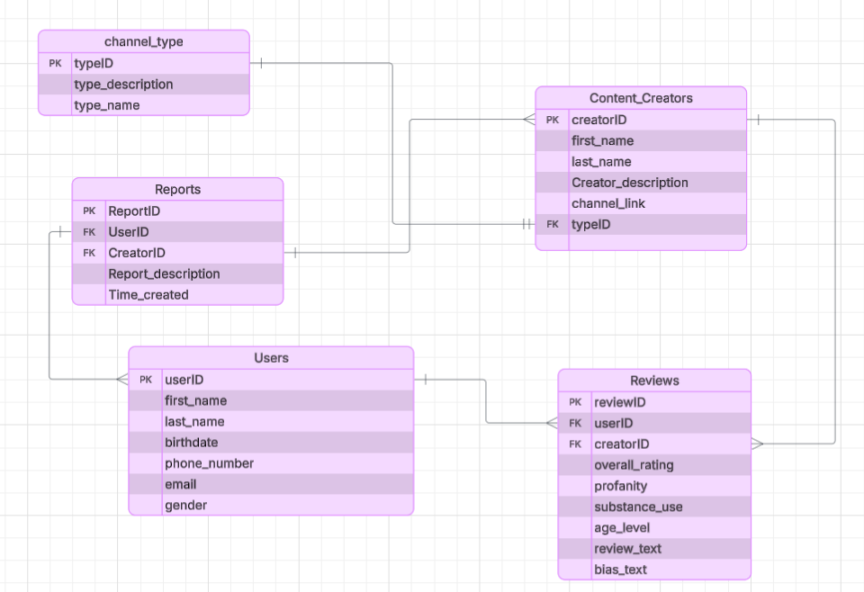

# Rate My Creator - App Summary

A responsive React prototype for discovering, evaluating, and rating content creators. This website is designed to help parents and children make informed choices about YouTube creators and their content. Many content creators on YouTube are known to spread hate and bring inappropriate content to the platform. Users can search for creators, review information and ratings, and give their own review and rate them on specific metrics. These reviews can help families identify creators whose content may be inappropriate and decide whom to avoid. The goal is to help parents feel more confident about who their children is watching on YouTube.

# ERD


# Tech Stack

Frontend: React, JavaScript (JSX), Vite, CSS, Lucide React (made with Codex)

Backend: Supabase

Database: PostgreSQL through Supabase

This approach fits our team as we want enough control to be able to iterate on the design as often as needed (something not possible with token-limited AI tools) while still having AI speed up that iteration process. With Codex we will be able to request larger changes from the AI as well as make personal, individual edits directly to the code. Supabase will work as both our backend and database hosting service to manage our data and communicate with the frontend. Our product relies mainly on frontend capabilities, not backend robustness, so having both the backend and database simplified into one service suites our needs.

# Prototype features

- Creator discovery, live search, and multi-category filtering
- Detailed creator profiles with scores, audience guidance, and rating breakdowns
- Rating form with required fields and 150-word limit
- Ratings save with a supabase-supported database
- Supabase email/password and Google authentication with persistent sessions
- User dashboard and editable account settings
- Issue-reporting modal
- Responsive desktop and mobile layouts

All creator and account data is fictional. Creator profiles are included in the
app, while community reviews can be loaded from Supabase when configured.

# Run locally

1. Open the project folder in a terminal.
2. Install the dependencies:

   ```bash
   npm install

3. Start the development server:
    ```bash
   npm run dev

4. Open the local address shown by Vita (normally http://localhost:5173).
The site works without database credentials, so contributors can browse the 
prototype immediately. To load and submit reviews, create `.env.local` with:

```bash
VITE_SUPABASE_URL=your-project-url
VITE_SUPABASE_PUBLISHABLE_KEY=your-publishable-key
```

Restart npm run dev after adding or changing these values. Do not commit .env.local; it is intentionally ignored by Git.

# Vertical Slice - Review Button
To test the working review flow, make sure Supabase is configured as described above, then:
1. Click Log in.
2. Sign in with Google or a registered email/password account.
3. Open any creator’s profile and click 'Rate this creator'.
4. Fill out the review form and submit it.
5. Refresh the page. Your authenticated session should remain active.
6. Return to the creator’s profile. Your submitted review should appear in the review list.
